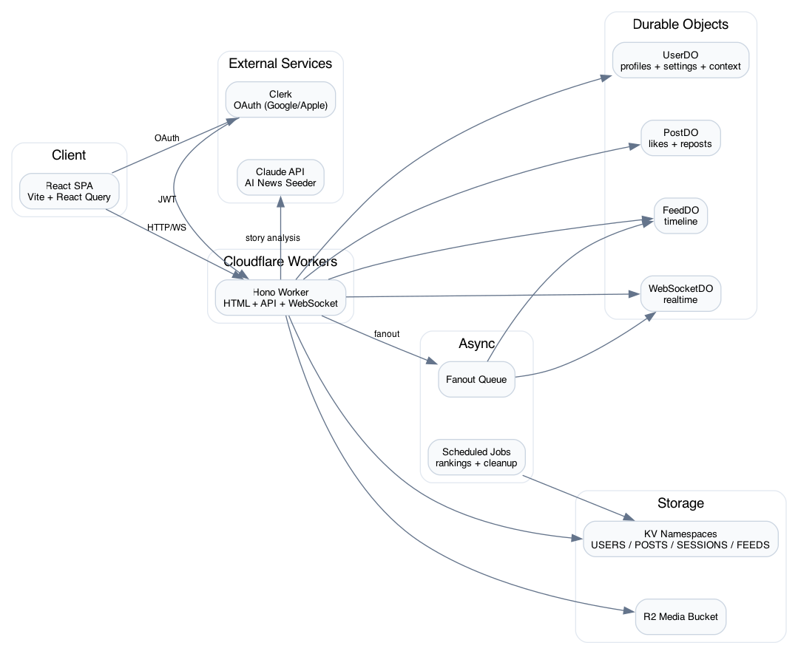

# The Wire

The Wire is a Twitter-style social network that keeps its code and data entirely on Cloudflare's developer platform, with no origin server or central database behind it, and leaves sign-in to Clerk. It exists as a reference for developers building stateful, multi-user applications on Workers, and a social network makes a demanding example because almost every feature asks something different of the platform: a follow has to change two people's state, a post has to reach every follower's timeline without making its author wait, a timeline has to be assembled and ranked on each read, and blocks, mutes and bans have to apply across all of it.

Because it is a whole application, those patterns appear next to the things a real product needs: posts of up to 280 characters with images or video, replies, quotes, reposts and likes, muted words, search, notifications, an admin dashboard for bans and takedowns, and a React single-page app with six themes.



## How it works

Each user has a `UserDO` Durable Object for their profile, settings and social graph, and a `FeedDO` holding up to 1,000 timeline entries, while each post has a `PostDO` that tracks its likes and reposts. A Durable Object is the single-threaded owner of its state, so updates to one user or one post are serialised without any locking. KV carries the read side, with post metadata, handle lookups, search indexes and cached rankings, which lets a page of posts come from batched KV reads instead of waking one object per post. R2 stores uploaded media.

Publishing a post shows how the work divides. The Worker initialises the `PostDO`, writes the metadata and indexes to KV, adds the post to the author's own `FeedDO` so that it appears for them straight away, and puts a fan-out message on a Queue. The Queue consumer then reads the author's followers from their `UserDO` and writes an entry into each follower's `FeedDO`, five at a time. Adding an entry is idempotent, so a retried message cannot duplicate a post in anyone's timeline. Reading the home timeline runs the other way: the Worker takes the reader's blocks, mutes and follows from `UserDO`, a window of posts from `FeedDO` and candidates from the Explore ranking in KV, then filters and ranks them into a page.

## Run it locally

You need Node.js 20 or later, which Wrangler 4 requires, and a [Clerk](https://clerk.com) application, because the API and the frontend both fail without Clerk keys. The Wire renders Clerk's own sign-in component, so people can sign in with whichever methods you enable there; the project was set up for Google and Apple.

```bash
git clone https://github.com/chrischabot/the-wire.git
cd the-wire
npm install
```

Create `.dev.vars` in the repository root. The publishable key here overrides the original project's key in `wrangler.toml`, and `JWT_SECRET` signs tokens for the email-and-password API described below.

```ini
JWT_SECRET=a-long-random-string
CLERK_SECRET_KEY=sk_test_your_key
CLERK_PUBLISHABLE_KEY=pk_test_your_key
```

The frontend reads its copy of the key at build time, from `web/.env.local`:

```ini
VITE_CLERK_PUBLISHABLE_KEY=pk_test_your_key
```

Then build the frontend and start the Worker:

```bash
npm run dev
```

The app runs at <http://localhost:8080>, with Wrangler simulating KV, R2, Durable Objects and Queues on your machine. Sign in, choose a handle and start posting. To make yourself an admin, add `INITIAL_ADMIN_HANDLE=yourhandle` to `.dev.vars` before you claim that handle.

A new network is empty, so the admin-only seed routes can create twenty demo accounts and a follow graph. Add `ADMIN_SECRET=your-admin-secret` to `.dev.vars`, restart the server and run:

```bash
for route in users follows; do
  curl -X POST "http://localhost:8080/debug/seed/$route" \
    -H "Origin: http://localhost:8080" \
    -H "X-Admin-Secret: your-admin-secret"
done
```

The routes that generate posts and replies call Claude and need `ANTHROPIC_API_KEY`; the top of [`src/handlers/seed.ts`](src/handlers/seed.ts) lists them in order. The demo accounts share a password that is in the public source, so keep them off public deployments.

## Try the API

The web app authenticates with Clerk session tokens, but the API also keeps an older email-and-password path, which is the quickest way to try it from a terminal, using `curl` and `jq`:

```bash
BASE=http://localhost:8080

TOKEN=$(curl -s -X POST $BASE/api/auth/signup \
  -H 'Content-Type: application/json' \
  -d '{"email":"ada@example.com","password":"Example-Passw0rd","handle":"ada"}' \
  | jq -r .data.token)

curl -X POST $BASE/api/posts \
  -H "Authorization: Bearer $TOKEN" -H 'Content-Type: application/json' \
  -d '{"content":"Hello from a Durable Object"}'

curl -H "Authorization: Bearer $TOKEN" $BASE/api/feed/home
```

Responses are JSON, shaped as `{ "success": true, "data": ... }` or `{ "success": false, "error": "..." }`. `GET /api/feed/global` is the public Explore feed, and `ws://localhost:8080/api/ws?token=$TOKEN` opens the live update socket. The routes are defined in [`src/handlers/`](src/handlers), and [`docs/architecture.md`](docs/architecture.md) has route tables and data schemas.

## Deploy to Cloudflare

The checked-in `wrangler.toml` uses legacy key-value Durable Object storage (`new_classes`). [Cloudflare now restricts that backend](https://developers.cloudflare.com/durable-objects/platform/pricing/) to paid accounts that already have a key-value-backed namespace. The steps below assume an eligible account; on a new account, first adapt and validate the migrations for SQLite-backed Durable Objects. Create the resources under your own account:

```bash
npx wrangler login
npx wrangler kv namespace create USERS_KV
npx wrangler kv namespace create POSTS_KV
npx wrangler kv namespace create SESSIONS_KV
npx wrangler kv namespace create FEEDS_KV
npx wrangler r2 bucket create the-wire-media
npx wrangler queues create fanout-queue
```

The repository still points at the original deployment and carries development routes, so make these changes before you deploy:

- `wrangler.toml`: replace each KV `id` and `preview_id` with your new IDs, set `CLERK_PUBLISHABLE_KEY` to your key, and add `WORKER_URL = "https://your-worker.your-subdomain.workers.dev"` under `[vars]`, because the CSRF check rejects browser writes from origins it doesn't know.
- `src/ssr/meta.ts`: set `SITE_URL`, which builds canonical URLs and share images.
- `src/constants.ts`: change `FOUNDER_HANDLE`, the account every new user follows automatically.
- `src/index.ts`: remove the `/debug` and `/debug/news` mounts, because those routes seed, wipe and repair data and exist for development.
- `src/handlers/auth.ts`: remove the password-reset routes before public deployment; restore them only after implementing and verifying the complete email-based reset flow.

`npm run deploy` does not build the frontend, so build it first, with your key in `web/.env.local`, and add the secrets once the Worker exists:

```bash
npx vite build
npm run deploy
npx wrangler secret put CLERK_SECRET_KEY
npx wrangler secret put JWT_SECRET
```

`ANTHROPIC_API_KEY` is optional and turns on the news job described below.

## Technical details

**Ranking.** The home timeline favours freshness. Recency has a three-hour half-life and carries most of the score, while engagement is log-scaled, decays over 18 hours and counts a reply as 4, a repost as 3 and a like as 1. A reader's own post stays pinned for its first ten minutes. About 85% of a page comes from followed accounts and 15% from the Explore ranking, moving to 60/40 when followed accounts have been quiet for the past two hours, and per-author caps stop one person filling the page. Pages are cached at the edge for 15 seconds, and the values are in [`src/constants.ts`](src/constants.ts).

**Scheduled jobs.** Cron triggers refresh the rankings every 15 minutes and clean up hourly and daily. When `ANTHROPIC_API_KEY` is set, a twice-daily job also fetches AI and machine learning news from RSS feeds and Hacker News, has Claude select and analyse the stories, and publishes posts and replies from synthetic personas, so that a new network has something to read.

**Abuse controls.** Origin checks guard state-changing requests, KV-backed counters rate-limit logins, posts, follows and uploads, login locks for 15 minutes after five failures, and uploads must match their declared type by magic bytes.

**Consistency.** Strong consistency stops at the boundary of each object. A follow writes to two `UserDO`s in parallel and attempts a rollback if one write fails, which narrows the window for a half-finished follow without being a transaction. KV can take a minute or so to show a write in other regions and the Queue can hold a batch for up to 30 seconds, so a follower can wait tens of seconds for a new post rather than seeing it at once.

**Limits.** Two of them change what you can expect from the code today:

- Live updates reach API clients only. The Worker pushes new posts and notifications through a per-user `WebSocketDO`, but `/api/ws` accepts only tokens from the email-and-password API, and the web app opens a socket only when it holds one. Browser sessions signed in through Clerk therefore stay unconnected, and learn about new activity from a 30-second unread-count poll and the next timeline fetch.
- Very large accounts need rework. An account's follower list lives inside one stored value in its `UserDO`, which Cloudflare caps at 128 KiB on this storage backend and which works out to several thousand followers. Fan-out also writes to every follower within a single queue invocation, so it is bounded by Workers' subrequest limits.

## Development

```bash
npm test            # unit and integration tests in Cloudflare's Workers test pool
npm run typecheck
npm run test:api    # starts wrangler dev on port 8787 and drives the HTTP API
```

Build the frontend once before running the tests, because `wrangler.toml` expects its assets in `dist/client`. Playwright specs live in `tests/e2e/playwright` and `tests/visual`; set `E2E_BASE_URL` when you run them, because the config otherwise targets the original deployment, and expect the login flows to need updating for Clerk.

`src/index.ts` is the Worker entry point and Queue consumer, `src/durable-objects/` holds the four objects, `src/handlers/` the routes and cron jobs, `src/services/` the news job and notifications, and `web/` the React app. [`CLAUDE.md`](CLAUDE.md) is a longer guide to the codebase.

## License and credits

MIT, see [LICENSE](LICENSE). Built by [Chris Chabot](https://github.com/chrischabot), working with the Maestro and Claude Code agents credited in the commit history. The interface follows Twitter/X's design, the themes draw on [shadcn/ui](https://ui.shadcn.com/), the routing uses [Hono](https://hono.dev/) and the icons come from [Lucide](https://lucide.dev/).
